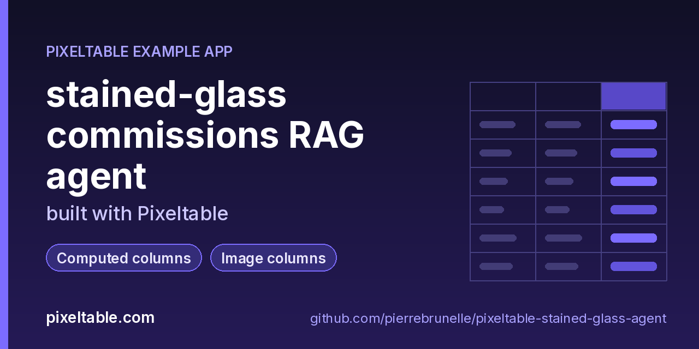

<!-- pixeltable-example-app: 20261120-stained-glass-agent -->
# Drive tool calls over images from a stored session in Python

Keep the agent's state in Pixeltable tables: commissions with their images and videos, stored session notes, and a Turns table whose computed columns send each question with its image and the notes to a vision model, let it call Python tools, and store the answer. No framework, checkpointer database or object store is needed.

**Replaces:** LangGraph + a checkpointer DB + S3



[](https://codespaces.new/pierrebrunelle/pixeltable-stained-glass-agent?quickstart=1)
[](https://pixeltable.com)
[](https://pypi.org/project/pixeltable/)
[](https://github.com/pixeltable/pixeltable)
[](LICENSE)

A stained-glass workshop keeps one row per commission: the brief, the window size, a reference image and an optional walkthrough video. Pixeltable names the dominant glass colour, makes thumbnails, asks gpt-4o-mini to describe each design and cuts every walkthrough into 2-second clips with video_splitter. A Notes table is the stored session. A Turns table is the agent: each question goes to gpt-4o-mini together with an attached image and the session notes, the model may call a price-quote tool and an async glass-stock tool, and the answer is stored next to the raw tool results. Needs an OpenAI API key.

[Pixeltable](https://pixeltable.com) is open-source, Python-native **multimodal AI data infrastructure**: tables, incremental computed columns, UDFs, indexes and serving in one library, running locally or on Pixeltable Cloud.

> ⭐ **Like this example?** Star [pixeltable/pixeltable](https://github.com/pixeltable/pixeltable) on GitHub. It helps other developers find it.

## What this example shows

- **Incremental computed columns** powered by plain Python UDFs (`@pxt.udf`)
- **Multimodal media columns** with configurable media destinations
- **Importable UDF module**: UDFs live in `udfs.py`; tables and queries live in `app.py` (Pixeltable resolves UDFs by module path)
- **`pixeltable.toml`** declares a local database and a **Pixeltable Cloud** database, so the same code deploys with `pxt db update`


## What's inside

| File | What it is |
|------|------------|
| `.devcontainer/devcontainer.json` | GitHub Codespaces / Dev Container config: Python 3.12, installs `requirements.txt` |
| `.github/social-preview.png` | Social preview image (1280x640) |
| `CITATION.cff` | Citation metadata (authors, license, release date, keywords) |
| `app.py` | Tables declared as Python classes and `@pxt.query` functions |
| `data/reference/C-101.png` | Sample data |
| `data/reference/C-102.png` | Sample data |
| `data/reference/C-103.png` | Sample data |
| `data/reference/C-104.png` | Sample data |
| `data/site-photo.png` | Sample data |
| `data/walkthrough/C-101.mp4` | Sample data |
| `data/walkthrough/C-102.mp4` | Sample data |
| `data/walkthrough/C-103.mp4` | Sample data |
| `make_data.py` | Generate reference images, two walkthrough videos and a site photo (offline, synthetic) |
| `pixeltable.toml` | Project config: the local database plus a Pixeltable Cloud database (sizing, deploy excludes) |
| `run.py` | Seed the workshop and ask the agent questions (python run.py seed | ask <id> "<question>") |
| `udfs.py` | Pixeltable UDFs (`@pxt.udf`) in their own importable module, imported by `app.py` |
| `requirements.txt` / `pyproject.toml` | Dependencies (`pixeltable>=0.7.25`) |

**Tables**

| Table | Stored columns | Computed columns |
|-------|---------|------------------|
| `commissions` | `commission_id`, `client`, `brief`, `width_cm`, `height_cm`, `reference`, `walkthrough` | `glass`, `thumb`, `look` |
| `walkthrough_clips` | - | `keyframe`, `glow` |
| `notes` | `commission_id`, `note` | `note_id` |
| `turns` | `commission_id`, `question`, `attachment` | `turn_id`, `notes`, `prompt`, `response`, `tool_results`, `answer` |
| `NewCommission` | `commission_id`, `client`, `brief`, `width_cm`, `height_cm`, `reference`, `walkthrough` | - |

## Run in your browser (GitHub Codespaces)

[](https://codespaces.new/pierrebrunelle/pixeltable-stained-glass-agent?quickstart=1)

1. Click **Open in GitHub Codespaces** above (or [this link](https://codespaces.new/pierrebrunelle/pixeltable-stained-glass-agent?quickstart=1)). The dev container installs Python 3.12 and `pixeltable>=0.7.25` from `requirements.txt`.
2. In the codespace terminal, create the tables, seed them and run the app:

   ```bash
   pxt schema update app.py glass
   python make_data.py          # synthetic window designs, walkthrough videos and a site photo (offline)
   pxt schema update app.py glass
   python run.py seed          # insert 4 commissions (pydantic models) and 2 session notes
   python run.py ask C-101 "What would a 60 x 90 cm panel with 40 pieces cost, and is cobalt in stock?"   # needs OPENAI_API_KEY
   ```


## Quickstart

Requires Python 3.11+ and `pixeltable>=0.7.25`.

```bash
git clone https://github.com/pierrebrunelle/pixeltable-stained-glass-agent.git
cd pixeltable-stained-glass-agent
python -m venv .venv && source .venv/bin/activate
pip install -r requirements.txt

# Create the tables in a local catalog directory named `glass`
pxt schema update app.py glass

python make_data.py          # synthetic window designs, walkthrough videos and a site photo (offline)
pxt schema update app.py glass
python run.py seed          # insert 4 commissions (pydantic models) and 2 session notes
python run.py ask C-101 "What would a 60 x 90 cm panel with 40 pieces cost, and is cobalt in stock?"   # needs OPENAI_API_KEY
```

## Deploy to Pixeltable Cloud

The same `app.py` runs on [Pixeltable Cloud](https://pixeltable.com). Sign in (or get a free trial database with `pxt new`), point the second database entry in `pixeltable.toml` at your own database, then deploy:

```bash
pxt login                       # or: export PIXELTABLE_API_KEY=<your-api-key>
# edit pixeltable.toml: name = 'pxt://<your-org>:<your-db>'
pxt db update pxt://<your-org>:<your-db>                 # build the image and upload the project
pxt schema update app.py pxt://<your-org>:<your-db>       # create the tables at the database root (no per-app folder)
```

Keep keys in environment variables or `pxt secret set`, never in code.

## Code walkthrough

**1. Business logic is plain Python, in `udfs.py`.** A `@pxt.udf` function can be used as a column expression. Pixeltable records UDFs by module path (`udfs.dominant_glass`), so they live in their own importable module rather than inline in the app: the daemon, serving workers and Pixeltable Cloud import it again by that path.

```python
# udfs.py
@pxt.udf
def dominant_glass(img: PIL.Image.Image) -> str:
    """Name of the glass colour that covers the most of the picture (coarse hue buckets)."""
    small = img.convert('RGB').resize((48, 48))
    counts: dict[str, int] = {}
    for r, g, b in small.getdata():
        h, s, v = colorsys.rgb_to_hsv(r / 255, g / 255, b / 255)
        if v < 0.25:
            continue  # lead lines
        name = 'opal white' if s < 0.15 else hue_name(h)
        counts[name] = counts.get(name, 0) + 1
    return max(counts, key=lambda k: counts[k]) if counts else 'opal white'
```

**2. Tables are Python classes (`app.py`).** Annotated attributes are stored columns; attributes assigned an expression are **computed columns** (`turn_id`, `notes`, `prompt`, `response`, `tool_results`, `answer`), evaluated incrementally on every insert or update and recomputed when their inputs change.

```python
# app.py
class Turns(TableModel, name='turns'):
    """One question to the workshop agent; the model call and the tool calls are computed on insert."""

    commission_id: pxt.String
    question: pxt.String
    attachment: pxt.Image
    turn_id = pxt.Column(value=pxtf.uuid.uuid7(), primary_key=True)

    notes = notes_for(commission_id)
    prompt = pack_notes(question, notes)
    response = openai.chat_completions(
        [
            {'role': 'system', 'content': SYSTEM_PROMPT},
            {
                'role': 'user',
                'content': [{'type': 'text', 'text': prompt}, {'type': 'image_url', 'image_url': attachment}],
            },
        ],
        model=AGENT_MODEL,
        tools=TOOLS,
        model_kwargs={'max_tokens': 200},
    )
    tool_results = openai.invoke_tools(TOOLS, response)
    answer = final_answer(response.choices[0].message.content.astype(pxt.String | None), tool_results)
```

**3. Queries are functions (`app.py`).** `@pxt.query` wraps a Pixeltable query so it can be called from Python or exposed as a route:

```python
# app.py
@pxt.query
def notes_for(commission_id: str):
    """Session notes of one commission, oldest first."""
    return Notes.where(Notes.commission_id == commission_id).order_by(Notes.note_id).select(Notes.note)
```

## FAQ

**Where does the agent's memory live?**

In the Notes table. A @pxt.query reads a commission's notes and a computed column packs them into every prompt.

**How do images reach the model?**

The Image column is passed as the image_url of a chat message inside a computed column, so Pixeltable handles encoding, caching and retries.

**How are tools defined?**

As plain @pxt.udf functions (one of them async) collected with pxt.tools(); openai.invoke_tools runs whatever the model asked for.

## Learn more

- 🌐 Website: https://pixeltable.com
- 📚 Docs: https://docs.pixeltable.com
- 💻 Source: https://github.com/pixeltable/pixeltable (⭐ star it if Pixeltable is useful to you)
- 📦 PyPI: https://pypi.org/project/pixeltable/
- 🧩 More example apps: https://pierrebrunelle.github.io/awesome-pixeltable-apps/

**[More Pixeltable example apps →](https://pierrebrunelle.github.io/awesome-pixeltable-apps/)**

---

<sub>Built as part of a daily series of Pixeltable example apps · Pixeltable 0.7.25 · Python, incremental computed columns · Licensed under Apache-2.0.</sub>
